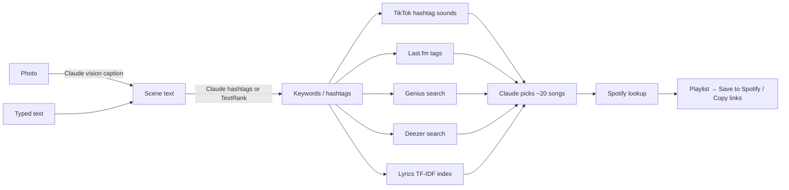

# Melodrip
### Turn a photo or a few words into a playlist.
**Authors:** Pure and Saki · **Live app:** [melodrip.vercel.app](https://melodrip.vercel.app) · [Original Colab notebook](https://colab.research.google.com/drive/1FV_B7by20IdGuBS1goGFBVbOFCEqbz_E?usp=sharing#scrollTo=e8cozxUzDFgl)

Melodrip started as a 2024 hackathon project that matched an image caption against song lyrics (the [original report](#original-hackathon-report-2024) is below). It is now a mobile web app built to feel like a native iPhone app. Claude describes your photo, the description becomes hashtags, the app gathers songs from TikTok and several music services, and has Claude pick a playlist you can save to Spotify.

## Features
- **Photo or Text toggle.** Caption a photo (taken with the camera, picked from the library, or pasted as a link), or skip captioning and type a scene or mood directly.
- **Side-by-side results.** Your photo appears next to its caption and hashtags, followed by about 20 songs with album art. Each song shows a label for the source that suggested it.
- **Save to Spotify** creates the playlist in your Spotify account. **Copy Spotify Links** works for anyone: paste the links into a Spotify playlist on desktop.
- **Installs like an app.** In Safari, tap Share, then **Add to Home Screen**. It opens full screen with its own icon and follows light and dark mode.

## How it works



1. **Describe the scene.** Claude Sonnet 5.5 writes a short caption for the photo: the subject, what's happening, the setting and the mood ([lib/caption.ts](lib/caption.ts)). If no Anthropic key is set, a vision model on Hugging Face writes it instead. The original app used BLIP, but Hugging Face's API no longer hosts it. In text mode, your words are used as they are.
2. **Pull out keywords.** In photo mode, Claude picks 3–5 hashtags along with the caption. In text mode, and whenever there's no Anthropic key, the original TextRank method, ported to TypeScript ([lib/keywords.ts](lib/keywords.ts)), ranks the words and keeps the top 5. TextRank can't rank the words of a single long sentence, because they all score the same, which is why Claude picks the photo hashtags.
3. **Gather candidate songs.** All sources run at the same time, and a source that fails or has no key is skipped ([app/api/playlist/route.ts](app/api/playlist/route.ts)):
   - **TikTok:** the sounds used in recent videos under up to 3 of the hashtags, ranked by how many videos use each sound ([lib/sources/tiktok.ts](lib/sources/tiktok.ts)).
   - **Last.fm:** the top tracks listeners have tagged with each keyword.
   - **Genius:** songs whose title or lyrics match each keyword.
   - **Deezer:** the top search results for each keyword.
   - **Lyrics index:** the original project's TF-IDF and cosine-similarity match against 20,000 songs from the Kaggle Spotify dataset.
4. **Curate.** Claude Sonnet 5.5 picks about 20 songs and orders them so the playlist flows ([lib/curate.ts](lib/curate.ts)). It keeps trending TikTok sounds that are real released songs, drops creators' "original sound" clips, keeps at most two songs per artist, and may add up to a third of the songs itself. Its output is structured JSON checked against a schema. Without an Anthropic key, the app alternates between sources instead.
5. **Match on Spotify.** The server looks up each pick in Spotify's catalog, all in parallel, and drops songs Spotify doesn't have ([lib/spotify.ts](lib/spotify.ts)).
6. **Save.** Spotify login runs in the browser using PKCE, so no secret is needed there. The app then creates a private playlist and adds the tracks ([lib/spotify-auth.ts](lib/spotify-auth.ts)).

The API streams progress back to the app, so the caption and hashtags appear right away while the slower sources (mostly TikTok) are still running.

## APIs and tools

| Service | Used for | Env variable | Cost |
|---|---|---|---|
| [Claude API](https://docs.claude.com) (Claude Sonnet 5.5) | Captioning photos; picking, filtering and ordering the playlist | `ANTHROPIC_API_KEY` | A few cents per playlist |
| [Hugging Face Inference Providers](https://huggingface.co/docs/inference-providers) | Backup photo captioning when there's no Anthropic key | `HF_TOKEN` | Small free monthly credit, then paid |
| [Apify](https://apify.com/clockworks/tiktok-scraper) TikTok scraper | Sounds used under each hashtag | `APIFY_TOKEN` | About $1.70 per 1,000 videos (~$0.10 per playlist) |
| [Last.fm API](https://www.last.fm/api) | Top tracks for a tag | `LASTFM_API_KEY` | Free |
| [Genius API](https://docs.genius.com) | Title and lyric search | `GENIUS_ACCESS_TOKEN` | Free |
| [Deezer API](https://developers.deezer.com/api) | Keyword track search | none | Free |
| [Spotify Web API](https://developer.spotify.com/documentation/web-api) | Track lookup, album art, saving playlists | `NEXT_PUBLIC_SPOTIFY_CLIENT_ID`, `SPOTIFY_CLIENT_SECRET` | Free (owner needs Premium) |
| [Kaggle Spotify Million Song Dataset](https://www.kaggle.com/datasets/notshrirang/spotify-million-song-dataset) | Lyrics for the TF-IDF index | none | Free |

Every key is optional, and each one turns on a single feature. With no keys at all, text mode still works using Deezer and the lyrics index, but photo mode needs a captioning key. [.env.example](.env.example) lists every variable, including optional ones like `HF_CAPTION_MODEL`, `APIFY_TIKTOK_ACTOR` and `TIKTOK_RESULTS_PER_HASHTAG`.

**Built with:**
- **App:** Next.js 16 (App Router) with React 19 and TypeScript, deployed on Vercel.
- **Server libraries:** `@anthropic-ai/sdk` and `zod` for the Claude call, and `stemmer` (Porter stemmer) for keywords.
- **Index builder:** Python with scikit-learn ([scripts/build_index.py](scripts/build_index.py)) precomputes the lyrics TF-IDF matrix as an inverted index, so the server needs no Python. Each term keeps its 60 highest-weighted songs, so scores closely approximate the original full comparison rather than exactly matching it.

## Project structure
```
app/
  page.tsx                 iOS-style UI (Photo/Text toggle, results, save/copy)
  api/playlist/route.ts    the pipeline; streams progress as NDJSON
  manifest.ts, icon.tsx    home-screen install and app icon
lib/
  caption.ts               photo captioning (Claude vision, Hugging Face backup)
  keywords.ts              TextRank keyword extraction
  recommend.ts             lyrics TF-IDF lookup
  sources/                 TikTok (Apify), Last.fm, Genius, Deezer
  curate.ts                Claude playlist curation
  spotify.ts               server-side Spotify search
  spotify-auth.ts          browser Spotify login (PKCE) and saving
data/lyrics-index.json     precomputed lyrics index
scripts/build_index.py     builds the index from the Kaggle CSV
Melodrip.py, Melodrip.ipynb  original 2024 Streamlit / Colab versions
```

## Running it

**Deploy to Vercel**
1. Import the repo at [vercel.com/new](https://vercel.com/new). It is detected as Next.js automatically.
2. Add whichever keys you have from [.env.example](.env.example).
3. For Spotify:
   - Create an app at [developer.spotify.com/dashboard](https://developer.spotify.com/dashboard).
   - Add the redirect URI `https://<your-domain>/` (and `http://127.0.0.1:3000/` for local testing).
   - Add the Spotify accounts that may save playlists under **User Management**.
4. Deploy.

**Local development**
```bash
npm install
cp .env.example .env.local   # skip if you already have .env.local
npm run dev                  # http://localhost:3000
```

### API keys and `.env.local`
Keys are kept in two places, and both need updating when a key changes:

| Where | Used by | How to edit |
|---|---|---|
| `.env.local` in the project folder | `npm run dev` and `npm run build` on your computer | Open it in an editor. One `NAME="value"` per line. |
| Vercel → Project → Settings → Environment Variables | The live site | Dashboard, or `npx vercel env add NAME production`. Redeploy afterwards (`npx vercel deploy --prod`). |

`.env.local` is listed in `.gitignore` and `.vercelignore`, so it is never committed or uploaded. Keep it private, and never paste keys into issues, commits or chats. [.env.example](.env.example) is the committed template, with every variable name and no values.

To copy the live site's keys into a fresh `.env.local` (for example, on a new computer), run:
```bash
npx vercel link                                       # once per computer
npx vercel env pull .env.local --environment=production
```
Variables stored as "Sensitive" in Vercel can't be read back. If they come through empty, copy them in by hand.

**Rotating a key:** create a new key at the provider (see the links in [.env.example](.env.example)), replace it in both places, then redeploy. Delete the old key at the provider only after the new one works.

**Testing Spotify save locally:** Spotify only redirects to addresses registered in your app's dashboard settings. To test "Save to Spotify" on your computer, add `http://127.0.0.1:3000/` as a redirect URI and open the app at `http://127.0.0.1:3000`, not `localhost`.

**Rebuild the lyrics index** (after changing `spotify_millsongdata.csv`):
```bash
pip install -r scripts/requirements.txt
npm run build:index
```

## Limits
- **Spotify saving is capped at 5 users.** Spotify's Development Mode (as of February 2026) lets only 5 allowlisted accounts save playlists, and the app owner needs Premium. Wider access needs Spotify's extended quota, which requires a registered business with about 250,000 monthly users. Everyone else can use Copy Spotify Links.
- **TikTok has no official API for hashtag sounds.** The app uses a third-party scraper, which is against TikTok's terms of service and can stop working if TikTok blocks it. The rest of the app keeps working if it does. Results are cached for 6 hours per server instance to limit cost.
- **Photo captions need the Anthropic key**, or Hugging Face credits for the backup captioner. Hugging Face's free monthly credit is small and runs out quickly.

---

# Original hackathon report (2024)

### Introduction:
April 20th, 2024 was Whitman College’s first hackathon. At this hackathon, Saki Bishop and Yuttanawee Buahom decided to participate as a two person team. At this hackathon, various ideas were put out but we were having a hard time settling on an idea, and thus were quite stumped as to what we should do. As we were racking our brains to find something unique and interesting to do, we found various models on huggingface that turns images into text and also classified lyrics into a music genre. Considering how fun it can be to play around with image generators, we were curious if we could combine the ideas of image to text and text to genre/mood to create a music playlist for a submitted image. The idea is that we would input a photo, which would then be given a caption that would next be analyzed into a theme, and then finally be grouped together with other songs of similar themes. With the usage of models from huggingface, we figured it could be possible to easily implement this despite there being many moving parts in this program.
With these hackathon roots in mind, we have named this program after our hackathon team name, melodrip, coming from the imagery of new songs dripping upon us through recommendation.

### Literature Review:
To get started on this project, we took a look at a YouTube video by Rithesh Sreenivasan titled “Text Summarization TextRank Algo Explain, spaCy pytextrank and genism python example #nlp“	, and also started reading on Cosine Similarity from a stackoverflow forum. 
Both of us were not too familiar with algorithms utilizing caption generation, and so the YouTube video was helpful in illuminating how text summarization works and how it is implemented through PageRank and TextRank. According to the video, there are two types of text summarization, extractive text summarization and abstractive text summarization. Extractive text summarization selects important sentences from a document to form a summary, and is grammatically correct but hard to read. Abstractive text summarization builds a semantic representation of the document, and utilizes paraphrasing techniques and at times adds original content to the summary. As we were planning on comparing generated captions with lyrics, it felt essential to focus on algorithms with extractive strategies rather than allowing the algorithm to add things that did not exist in either texts. PageRank had a focus on extracting information from website pages, and thus we settled on utilizing TextRank instead. 
As for the stackoverflow forum, we learned that the Scikit Learn library has a simple and easily implementable cosine metric. But to compare documents represented by keywords, it is important to have vector representations of the documents. It brings attention to TF-IDF vectorization, which was a concept we were more familiar with thanks to our Applied Machine Learning course. 

### Data Collection and Preprocessing:
The main data collection and preprocessing done for this project revolves around taking CSVs of song titles and lyrics, and then applying text normalization methods to make more accurate correlations. We also did the same preprocessing on the captions created by our image to caption generator. 
Our text normalization was first tokenizing the words, getting rid of any stop words or punctuation, and then stemming words that could be stemmed. 
Originally, as this project started off for the hackathon, we started the project using Taylor Swift’s discography as we were able to find a nice compilation of her songs by shaynak on github. This CSV contained the title, the album name, and the lyrics. When we were using this CSV, we took out the album information as it isn’t essential for our project. We first got rid of brackets that indicated certain sections such as [Chorus] and [Pre-chorus]. Next we applied our normalization method described above. As we worked with this CSV however, we realized that the 256 songs compiled was not enough to make any meaningful connections. 
Instead, we found a Kaggle dataset that contained a million songs from Spotify. This dataset contains the song title, artist name, lyrics, and links to the song. We hoped that we could utilize the links in the CSV to help direct our users to the songs directly, but the links did not always direct us to a Spotify link. Thus, we decided to get rid of the link section and get back to figure out a playlist creation algorithm at a later time. Next, because our normalization function did not work for the lyrics, we decided to just do some basic preprocessing of getting rid of ‘\n’ and ‘ ‘.

### Methodology:
Our project largely dealt with transfer learning for the caption generator, the TextRank algorithm, TF-IDF vectorization, and cosine similarity. We also used StreamLit to create the user interface.
First, the model used for the image captioning was BLIP-2 from Hugging Face. Proposed by Junnan LI, Dongxu Li, Silvio Savarese, and Steven Hoi, BLIP-2 is “a generic and efficient pre-training strategy that bootstraps vision-language pre-training from off-the-shelf frozen pre-trained image encoders and frozen large language models”. We had a couple other image captioning models that we worked with, but BLIP-2 had the most sentences that made sense, and thus BLIP-2 was chosen as the model to utilize in our project.
The second algorithm we dealt with was TextRank. TextRank is a graph-based ranking model for text processing, used to extract the most relevant sentences or words. The graph in question takes key words as nodes, and the connections between each word as weighted edges. With this graph, TextRank assigns scores for each node depending on how many neighbors (or how many edges) it has. After TextRank was established, we were able to extract the top keywords by sorting the words by their score using lambda and turning the top 5 words into a list. 
TF-IDF vectorization was mainly used to match the extracted keywords from the caption and match it to the lyrics of the song. TF-IDf vectorizer compares the frequency of a word in a document with the number of documents the word appears in and assigns a measure of originality. We applied the TF-IDF vectorizer on all of the lyrics and turned it into a lyrics matrix. We also applied another TF-IDF vectorizer specifically on the extract keywords from the TextRank algorithm. Finally, we looked to find the similarity between the extracted keywords and lyrics matrix using cosine similarity. Cosine similarity is an algorithm that compares the angles of two vectors to measure how close the vectors are pointing to the same direction. With establishing similarity scores, we sorted the similarity scores so that we can extract the top 5 songs as our recommended songs. 
This project was our first time dealing with Sreamlit, but it was relatively simple. After importing the Streamlit app into Google Colab, we created a simple user interface in our main function. With guidance from a medium article by Yash Kavaiya, we were able to successfully run the interface through creating a local tunnel, and establishing a tunnel password by putting in our IP address. 

### Experimental Setup:
Our experimental set up consisted of testing the models over and over again with one photo, and printing out the results to see if it would make sense as a person logically. For the first round of testing we focused on a picture of a dog that is wearing sunglasses and licking its face (Figure 1). This will also be the example we will be showing in the results section. 


For the image captioning section, we ran the picture through around 4 different image captioning algorithms that were available to us on Hugging Face. After selecting the caption that made the most sense and captured the essential parts of the image (i.e. a caption that says “a dog wearing sunglasses and a collar” makes more sense than “a dog sitting in front of a white background”), we moved to testing the keyword extraction process. This also consisted of printing the keywords and adjusting how weight is assigned depending on what keywords were being printed out. Finally, to make sure that the song recommendation algorithm made sense, we had some code that would print the lyrics and the similarity score so that we could compare the extracted keywords and lyrics side by side. 

### Results:
Ultimately, we were able to create a fun recommending system that takes in an image and compares the automatically generated image caption with various lyrics to recommend a song. As we have mentioned briefly, we will be focusing on the test image to display our results. 
	For the picture of the white dog with funky sunglasses that is licking itself, the generated caption was “there is a dog wearing sunglasses and a collar with a collar”. After going through the preprocessing, TextRank, and keyword extraction functions, the key words were deemed as ‘collar’, ‘dog’, ‘wear’, ‘sunglass’. The following is a visualization of the graph that was fed into the buildGraph function (figure 2). 


The next graph is the table showing the assigned TextRank score and the keywords (figure 3). 


The TextRank visualization shows that all words have the same score except for collar, which we have noticed appeared twice in the image captioning. When compared with the lyrics matrix created with the TF-IDF vectorization, most songs that showed up were dog related as most of these songs would contain the words ‘dog’ and ‘collar’. The following table is the visualization of the 10 songs with the highest similarity scores (figure 4). 


As we can see, even with the seemingly absurd photo of a dog, it was possible to find songs with similarity scores around 0.8, which is quite high. We kept the recommended songs within 5 songs, as the scores started to go under the similarity score of 0.8. For the songs that were recommended for this photo, it consisted of “The Dog” by Otis Redding at a score of about 0.8869, “Walk the Dog” by Eddie Cochran at about 0.8604, “I’m a Dog” by Gucci Mane at about 0.8218, “Dog Ear Dog” by Weird Al Yankovic at about 0.7891, and “Move It On Over” by Hank Williams at about 0.7847.
	Here is another instance of a photo running through this project. We have the following photo of a hammock on a palm tree on a beach side at sunset (figure 5). The caption given for this photo was “a close up of a hammock hanging from a palm tree on a beach”. When it was run through the keyword extractor, the keywords were ‘close’, ‘hammock’, ‘palm’, and ‘tree’. As each of these words showed up once, the TextRank scores were equal for each key word and thus the figures for the graph and TextRank visualization will be omitted. Figure 6 shows the top 10 recommended songs based off of the similarity scores. 


The songs that were recommended for the second photo consisted of “Hang On” by Weezer at a score of about 0.9664, “hang on in there” by John Legend at about 0.8269, “Busy Signal” by Dolly Parton at about 0.8070, “Hang Fire” by the Rolling Stones at about 0.7669, and “Hang On” by Michael W. Smith at about 0.7609. Again, we can see the decrease in similarity scores in around 5 songs, so 5 songs seemed the best number to recommend to our users. 

### Discussion:

Our project became something that is very fun to play around with. Not all of the songs recommended could be considered as highly accurate considering that scores tend to go down within 5 songs. This is largely due to the limiting quality of automated caption generators and the amount of song data that was fed into the project. 		
Our results were highly reliant on the number of unique words used in the caption generated by the submitted image. This meant that there is a good amount of overfitting between the key words and song lyrics, which had led to the similarity scores dropping under 0.8 within the first 5 songs. We attempted to improve this by looking for an image captioning model that provided longer sentences. However, the typical usage of image captioning expects the model to provide concise explanations, and thus most of the image captioning models found provided very precise and short image descriptions. Feeding the generated caption into another elaborative caption model poses the possibility of adding things unrelated to the image, and thus we were restricted to the shorter but accurate image captioning models. 
Another contribution to this limit would be the amount of songs fed into the project. As we were coding on Google Colab, the million songs provided from the Kaggle CSV was quite large and used up a lot of the RAM of our computers. However, if we were to add even more songs and lyrics, and were to push this project through a computer with more processing space, we would be able to increase the similarity scores further. Spotify had over 100 million songs on their platform. If more of these songs could be used in our project, we will be able to produce higher similarity rates as there are more unique words for the project to analyze. 

### Conclusion and Future Scope:

In the end, through the creation of an image to music playlist generator, we have learned alot about TextRank, vectorization, and cosine similarity. In the future, as mentioned in the section above, we would be interested in utilizing a database with even more songs to improve on our similarity scores. There is also some interest in creating a caption generator that focuses on accuracy and detail over accuracy and conciseness, so that the project has more varied weight in the keywords and ultimately connects to a more precise similarity rate. 
While it was not discussed as much in this report, we are also interested in making the user interface more enjoyable for the user. Currently, it is quite blank and also does not have an easy way to access the songs. Our next goal is to make it more colorful and also find a way to create a playlist that the user could press and listen to on the spot. 

### References:
“About Spotify.” Spotify, April 23, 2024. https://newsroom.spotify.com/company-info/.

ellen, and scipilot. “Cosine Similarity between Keywords.” Stack Overflow, December 13, 2018. https://stackoverflow.com/questions/53753614/cosine-similarity-between-keywords.
Kavaiya, Yash. “How to Run STREAMLIT Code in Google Colab.” Medium, November 11, 2023. https://medium.com/@yash.kavaiya3/running-streamlit-code-in-google-colab-involves-a-few-steps-c43ea0e8c0d9.

Li, Junnan, Dongxu Li, Silvio Savarese, and Steven Hoi. “BLIP-2.” Hugging Face, January 30, 2023. https://huggingface.co/docs/transformers/main/model_doc/blip-2.
Mahajan, Shrirang. “Spotify Million Song Dataset.” Kaggle, November 21, 2022. https://www.kaggle.com/datasets/notshrirang/spotify-million-song-dataset/discussion.

Shaynak. “Taylor-Swift-Lyrics/Songs.Csv at Main · Shaynak/Taylor-Swift-Lyrics.” GitHub, April 2024. https://github.com/shaynak/taylor-swift-lyrics/blob/main/songs.csv.

Sreenivasan, Rithesh. “Text Summarization TextRank Algo Explained , Spacy Pytextrank and Genism Python Example #NLP.” YouTube, October 30, 2020. https://www.youtube.com/watch?v=qtLk2x59Va8. 

