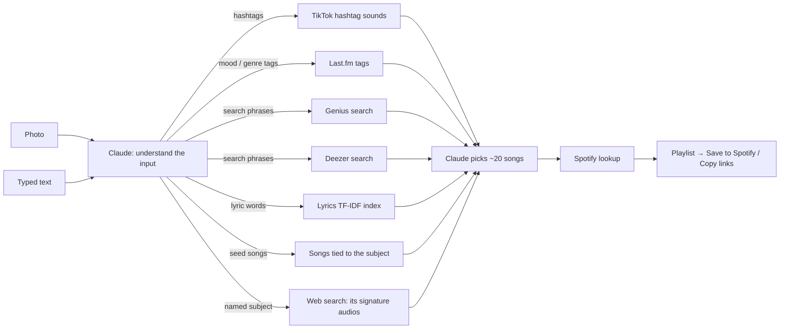

# Melodrip
### Turn a photo or a few words into a playlist.
**Author:** Pure (Yuttanawee Buahom) · **Live app:** [melodrip.vercel.app](https://melodrip.vercel.app) · [Original Streamlit app (2024)](https://melodrip.streamlit.app) · [Original Colab notebook](https://colab.research.google.com/drive/1FV_B7by20IdGuBS1goGFBVbOFCEqbz_E?usp=sharing#scrollTo=e8cozxUzDFgl)

Melodrip started as a 2024 hackathon project that matched an image caption against song lyrics (the [original report](#original-hackathon-report-2024) is below). It is now a mobile web app built to feel like a native iPhone app. Claude works out what your photo or text refers to and what people associate with it. The app then searches TikTok and several music services with that context, and Claude picks a playlist you can save to Spotify. Typing "maddy perez" gets you Euphoria's soundtrack and the audios used in Maddy edits, not songs that happen to contain "maddy" or "perez".

## Features
- **Photo or Text toggle.** Caption a photo (taken with the camera, picked from the library, or pasted as a link), or skip captioning and type a scene or mood directly.
- **Side-by-side results.** Your photo appears next to its caption and hashtags, followed by about 20 songs with album art. Each song shows a label for the source that suggested it, plus a one-line reason.
- **Save to Spotify** creates the playlist in your Spotify account. **Copy Spotify Links** works for anyone: paste the links into a Spotify playlist on desktop.
- **Installs like an app.** In Safari, tap Share, then **Add to Home Screen**. It opens full screen with its own icon and follows light and dark mode.

## How it works



1. **Understand the input** ([lib/understand.ts](lib/understand.ts)). Claude Sonnet 5.5 reads the photo or text and works out what it refers to: a person, a character, a show, a meme, an aesthetic, or just a scene. It considers what people associate with it, especially on TikTok, and returns a **search plan**, giving each source the kind of query it's good at:
   - **The named subject**, if there is one, e.g. "Maddy Perez (Euphoria)". Plain scenes have none.
   - **Hashtags** people actually use on TikTok, e.g. `#maddyperez #euphoria #baddie`, plus 1–2 **TikTok searches** such as "maddy perez edit".
   - **Search phrases** for Deezer and Genius, e.g. "euphoria soundtrack".
   - **Mood and genre tags** for Last.fm, e.g. "rnb", "dark pop".
   - **Lyric words** for the original lyrics index.
   - **Seed songs:** up to 8 songs strongly tied to the subject, such as audios famous in edits about it or its soundtrack.

   For a photo, the same call also writes the caption and notices anything recognisable, such as a famous person, a film still or a landmark. The app shows the caption, a line explaining the context (for example "Maddy Perez is a main character from HBO's Euphoria…"), and the hashtags.

   **Why this step exists:** the earlier approach split the input into words and searched each one separately. "maddy perez" became #maddy and #perez, which find nothing useful. Knowing the context is what finds the right music.

   **Without an Anthropic key**, the original TextRank method ([lib/keywords.ts](lib/keywords.ts)) picks the keywords. Short inputs are also kept whole: "maddy perez" also searches as `#maddyperez` and as the full phrase. Photos are then captioned by a Hugging Face vision model instead.
2. **Gather candidate songs.** All sources run at the same time, each with its part of the plan. A source that fails or has no key is skipped ([app/api/playlist/route.ts](app/api/playlist/route.ts)):
   - **Signature-audio lookup** (named subjects only): a separate Claude call searches the web for the songs famously used in TikTok edits, trends and memes about the subject, and lists only songs the results mention. This is its own step because, asked to plan and search in one call, Claude often skipped the search and answered from memory, which misses which exact audio a trend uses. These songs lead the candidate list.
   - **TikTok:** one scraper run covering the hashtag feeds (recent posts) and the keyword searches (TikTok's top videos), up to 4 queries in total ([lib/sources/tiktok.ts](lib/sources/tiktok.ts)). Each video adds log₁₀(its views) to its sound's score, so an audio used in a few viral edits outranks one used in many videos nobody watched.
   - **Last.fm:** the top tracks listeners have tagged with each mood or genre tag.
   - **Genius:** songs whose title or lyrics match each search phrase.
   - **Deezer:** the top results for each search phrase.
   - **Lyrics index:** the original project's TF-IDF and cosine-similarity match against 20,000 songs from the Kaggle Spotify dataset.
   - **Seed songs** from step 1.
3. **Curate.** Claude Sonnet 5.5 picks about 20 songs and orders them so the playlist flows ([lib/curate.ts](lib/curate.ts)). It's given the context as well as the candidates.
   - **Named subjects:** for a person, character, show or aesthetic, it opens with the subject's signature audio, then the other songs tied to it and the most-viewed TikTok sounds that are real songs. It leaves out candidates that only share a word with the input.
   - **Plain scenes:** it matches the mood.
   - **Rules:** it drops creators' "original sound" clips and keeps at most two songs per artist. Its own picks, including the seed songs, are capped at half the list.
   - **Without an Anthropic key,** the app alternates between sources instead.
4. **Match on Spotify.** The server looks up each pick in Spotify's catalog, all in parallel, and drops songs Spotify doesn't have, including any invented or mislabelled ones ([lib/spotify.ts](lib/spotify.ts)).
5. **Save.** Spotify login runs in the browser using PKCE, so no secret is needed there. The app then creates a private playlist and adds the tracks ([lib/spotify-auth.ts](lib/spotify-auth.ts)).

The API streams progress back to the app, so the caption, context and hashtags appear within a few seconds while the slower sources are still running. A plain scene takes about 15 seconds when its TikTok results are cached. A named subject adds the web lookup, which takes about 15–25 seconds but runs alongside TikTok. New TikTok queries take 30–60 seconds, because the scraper has to start up and collect videos, and big hashtags like #euphoria are the slowest. Repeat queries are cached for 6 hours.

## Integrations: what, why, how and cost

Melodrip combines several services. Each one is optional and switches on when its key is set (see [.env.example](.env.example)). If a service fails or has no key, the app skips it and builds the playlist from the rest.

### Cost per playlist at a glance

| Service | Cost per playlist | Free allowance |
|---|---|---|
| Claude: search plan (includes the photo caption) | ~$0.005–0.01 | None (pay as you go) |
| Claude: signature-audio web lookup (named subjects only) | ~$0.03–0.05 (3 web searches at $0.01 each, plus tokens) | None (pay as you go) |
| Claude: playlist curation | ~$0.02–0.04 | None (pay as you go) |
| Apify TikTok scraper | ~$0.10–0.14 (60–80 videos), $0 when cached | $5 credit/month on the free plan (about 35–50 playlists) |
| Spotify, Last.fm, Genius, Deezer | $0 | Free (rate limited) |
| Hugging Face (backup captions only) | ~$0.001 | $0.10/month free, $2/month with PRO |
| Vercel hosting, GitHub | $0 | Free Hobby plan / free public repo |
| **Total** | **~$0.13–0.18 for a plain scene, ~$0.17–0.24 for a named subject** (about $0.03–0.10 when TikTok is cached) | |

The Claude figures are estimates: about 1,500 input and 800 output tokens per search plan, and 4,000 input and 1,000–3,000 output tokens per curation, at Claude Sonnet 5.5's $2 per million input tokens and $10 per million output tokens. TikTok is the largest cost. Lower `TIKTOK_RESULTS_PER_HASHTAG` to reduce it, or remove `APIFY_TOKEN` to turn TikTok off.

### Claude API (Anthropic): understanding the input and curating
- **What:** Claude Sonnet 5.5 does up to three jobs per playlist:
  1. **Search plan** ([lib/understand.ts](lib/understand.ts)): it works out what the photo or text refers to, then returns the named subject, hashtags, TikTok searches, search phrases, mood tags, lyric words and seed songs that each source uses. For photos, it also writes the caption in the same call.
  2. **Signature-audio lookup** (named subjects only): with the [web search tool](https://docs.claude.com/en/docs/agents-and-tools/tool-use/web-search-tool), it finds the songs famously used in TikTok edits and memes about the subject. It answers in plain text, one song per line, because when asked for JSON it tended to skip the search.
  3. **Curation** ([lib/curate.ts](lib/curate.ts)): it chooses and orders about 20 songs from all the candidates.
- **Why:**
  - **Search plan:** people type names, characters, shows, memes and aesthetics, not just scenes. Searching each word on its own misses the point: "maddy perez" means Euphoria, the baddie aesthetic and Maddy edit audios. Only a model with broad cultural knowledge can make that connection, and it also replaces BLIP, which Hugging Face's API no longer hosts and whose captions were short (a limitation the 2024 report notes).
  - **Curation:** the sources return noisy matches. A song called "Coffee" isn't necessarily a coffee-shop song, and many TikTok sounds are creators' "original sound" clips rather than real songs. Claude judges fit and mood, removes duplicates, limits each artist to two songs, and recognises which TikTok sounds are released songs.
- **How:**
  - **Request:** the Messages API through `@anthropic-ai/sdk`, with structured outputs. A Zod schema guarantees valid JSON.
  - **Effort:** `low` for the search plan and `medium` for curation, to keep it fast.
  - **Refusals:** `fallbacks: "default"` re-runs a declined request on another Claude model.
  - **Without a key:** TextRank keywords, with short inputs also kept whole, replace the search plan, and a simple mix of the sources replaces curation.
- **Cost:** about $0.03–0.05 per playlist, plus $0.03–0.05 for the web lookup on named subjects (see above). Sign up and add billing at [console.anthropic.com](https://console.anthropic.com).
- **Key:** `ANTHROPIC_API_KEY`

### Apify TikTok scraper: trending sounds per hashtag
- **What:** for the top 3 hashtags in the search plan, it collects the sounds used in about 20 recent TikTok videos each, then ranks the sounds by how many videos use them ([lib/sources/tiktok.ts](lib/sources/tiktok.ts)).
- **Why:** TikTok is where songs trend. A sound that keeps showing up under #maddyperez or #beach fits in a way lyrics matching can't, which is why the hashtags come from the context-aware search plan rather than from splitting the input into words. TikTok has no official API for this: the Research API is for approved academic researchers, and Creative Center has no API. That leaves third-party scrapers.
- **How:**
  - **Scraper:** one synchronous run of the [`clockworks/tiktok-scraper`](https://apify.com/clockworks/tiktok-scraper) actor via Apify's `run-sync-get-dataset-items` endpoint, with every media download turned off.
  - **Ranking:** sounds are grouped by name and artist, then counted.
  - **Cache:** results are cached for 6 hours per server instance.
  - **Settings:** change the actor with `APIFY_TIKTOK_ACTOR` and the videos per hashtag with `TIKTOK_RESULTS_PER_HASHTAG`.
- **Cost:** about $1.70 per 1,000 videos. That's roughly $0.10 per playlist, and repeated hashtags cost nothing while cached. The free plan includes $5 of credit a month.
- **Caveat:** scraping is against TikTok's terms of service and can break if TikTok blocks the scraper. If it does, the app keeps working without TikTok.
- **Key:** `APIFY_TOKEN` (from [console.apify.com](https://console.apify.com) → Settings → API & Integrations)

### Spotify Web API: matching tracks and saving playlists
- **What:**
  - **Matching:** each picked song is looked up in Spotify's catalog, which gives the exact track, its link and album art ([lib/spotify.ts](lib/spotify.ts)).
  - **Saving:** "Save to Spotify" creates a private playlist in the user's own account ([lib/spotify-auth.ts](lib/spotify-auth.ts)).
- **Why:** users want to listen right away. Matching also removes picks that don't exist on Spotify, such as invented or mislabeled songs.
- **How:**
  - **Search:** runs on the server with the client-credentials flow, in parallel for all songs. It tries an exact `track:`/`artist:` search first, then a looser free-text search.
  - **Login:** saving uses Authorization Code with PKCE in the browser, so the secret never reaches the browser.
  - **Saving:** the app then calls `POST /me/playlists` and `POST /playlists/{id}/items` (Spotify's endpoints since February 2026).
  - **Copy Spotify Links** copies every track link, so anyone can paste the playlist into Spotify.
- **Cost:** free. In Development Mode, the app owner needs Spotify Premium.
- **Caveat:** in Development Mode, only **5 allowlisted accounts** can save playlists. Wider access needs Spotify's extended quota, which requires a registered business with about 250,000 monthly users.
- **Keys:** `NEXT_PUBLIC_SPOTIFY_CLIENT_ID`, `SPOTIFY_CLIENT_SECRET` (from [developer.spotify.com/dashboard](https://developer.spotify.com/dashboard))

### Last.fm API: songs listeners tagged with the keyword
- **What:** `tag.getTopTracks` returns the top 10 tracks for each mood or genre tag in the search plan, such as "rnb", "dark pop" or "summer" ([lib/sources/music-apis.ts](lib/sources/music-apis.ts)).
- **Why:** Last.fm tags come from real listeners and describe mood and setting, not just title words. That makes them the best match for "what does this scene sound like".
- **Cost:** free for non-commercial use, with an API key.
- **Key:** `LASTFM_API_KEY` (from [last.fm/api/account/create](https://www.last.fm/api/account/create))

### Genius API: title and lyric matches
- **What:** a search that matches song titles and lyrics for each search phrase, keeping the top 6 per phrase.
- **Why:** it carries on the original project's lyrics-matching idea, using a live catalog instead of 20,000 songs.
- **Cost:** free, with a client access token.
- **Key:** `GENIUS_ACCESS_TOKEN` (from [genius.com/api-clients](https://genius.com/api-clients))

### Deezer API: keyword search
- **What:** a public track search for each search phrase (e.g. "euphoria soundtrack"), keeping the top 8 per phrase.
- **Why:** it needs no key, so the app always has popular, real tracks even with nothing configured.
- **Cost:** free, no key.

### Lyrics TF-IDF index: the original 2024 algorithm
- **What:** the hackathon's TextRank → TF-IDF → cosine-similarity matching against 20,000 songs from the [Kaggle Spotify Million Song Dataset](https://www.kaggle.com/datasets/notshrirang/spotify-million-song-dataset) ([lib/recommend.ts](lib/recommend.ts)).
- **Why:** it keeps the project's original method, and it works offline with no key.
- **How:**
  - **Index:** [scripts/build_index.py](scripts/build_index.py) uses scikit-learn to precompute the TF-IDF matrix as an inverted index (`data/lyrics-index.json`). Each term keeps its 60 highest-weighted songs.
  - **Scoring:** a keyword's cosine score is then a lookup, so the server needs no Python. The scores closely approximate the original full comparison rather than exactly matching it.
- **Cost:** free.

### Hugging Face Inference Providers: backup captions
- **What:** a vision model (default `google/gemma-4-26B-A4B-it`) captions photos, but only when no Anthropic key is set.
- **Why:** it keeps photo mode working without Claude. BLIP itself is no longer offered by Hugging Face's API.
- **Cost:** free users get $0.10 of credit a month, which runs out quickly. PRO ($9/month) includes $2 a month, then pay as you go.
- **Key:** `HF_TOKEN`; `HF_CAPTION_MODEL` is optional.

### Hosting and code
- **GitHub:** this repository is the source of truth. Pushing to `main` deploys the app.
- **Vercel:** hosts the site and runs the API. It's connected to this repository, builds every push to `main` automatically, and stores the production keys. It's free on the Hobby plan, which is for non-commercial projects.
- **Framework and libraries:**
  - **App:** Next.js 16 (App Router), React 19 and TypeScript.
  - **Server libraries:** `@anthropic-ai/sdk` and `zod` for Claude, and `stemmer` (Porter stemmer) for TextRank keywords.

## Project structure
```
app/
  page.tsx                 iOS-style UI (Photo/Text toggle, results, save/copy)
  api/playlist/route.ts    the pipeline; streams progress as NDJSON
  manifest.ts, icon.tsx    home-screen install and app icon
lib/
  understand.ts            Claude search plan: context, hashtags, phrases, tags, seed songs
  caption.ts               image input + Hugging Face backup captioning
  keywords.ts              TextRank keyword extraction (fallback without Claude)
  recommend.ts             lyrics TF-IDF lookup
  sources/                 TikTok (Apify), Last.fm, Genius, Deezer
  curate.ts                Claude playlist curation
  spotify.ts               server-side Spotify search
  spotify-auth.ts          browser Spotify login (PKCE) and saving
data/lyrics-index.json     precomputed lyrics index
scripts/build_index.py     builds the index from the Kaggle CSV
legacy/                    original 2024 Streamlit app (+ its requirements.txt), Colab notebook, report figures
```

## Running it

**Deploying: push to GitHub**

The live site deploys automatically from this repository:
```bash
git checkout -b my-change        # work on a branch
git commit -am "Describe the change"
git push -u origin my-change     # open a pull request on GitHub
```
Merging the pull request into `main` deploys it to the live site within a minute or two. You don't need to run any Vercel commands.

**First-time setup** (only needed for a fresh copy of the project):
1. Import the repo at [vercel.com/new](https://vercel.com/new). It's detected as Next.js automatically.
2. Add the keys from [.env.example](.env.example) under Project → Settings → Environment Variables.
3. For Spotify:
   - Create an app at [developer.spotify.com/dashboard](https://developer.spotify.com/dashboard).
   - Add the redirect URI `https://<your-domain>/` (and `http://127.0.0.1:3000/` for local testing).
   - Add the Spotify accounts that may save playlists under **User Management**.

**Local development**
```bash
npm install
cp .env.example .env.local   # skip if you already have .env.local
npm run dev                  # http://localhost:3000
```

### API keys and `.env.local`
Keys are kept in two places, and both need updating when a key changes:

| Where | Used by | How to edit |
|---|---|---|
| `.env.local` in the project folder | `npm run dev` and `npm run build` on your computer | Open it in an editor. One `NAME="value"` per line. |
| Vercel → Project → Settings → Environment Variables | The live site | In the dashboard. Then redeploy: push any commit to `main`, or use **Redeploy** on the latest deployment. |

`.env.local` is listed in `.gitignore` and `.vercelignore`, so it is never committed or uploaded. Keep it private, and never paste keys into issues, commits or chats. [.env.example](.env.example) is the committed template, with every variable name and no values.

**On a new computer:** copy `.env.example` to `.env.local` and fill in each key. Every variable in `.env.example` has a link to where you get it.

**Rotating a key:** create a new key at the provider (see the links in [.env.example](.env.example)), replace it in both places, then redeploy. Delete the old key at the provider only after the new one works.

**Testing Spotify save locally:** Spotify only redirects to addresses registered in your app's dashboard settings. To test "Save to Spotify" on your computer, add `http://127.0.0.1:3000/` as a redirect URI and open the app at `http://127.0.0.1:3000`, not `localhost`.

**Rebuild the lyrics index** (after changing `spotify_millsongdata.csv`):
```bash
pip install -r scripts/requirements.txt
npm run build:index
```

## Limits
- **Spotify saving is capped at 5 allowlisted users** while the app is in Development Mode. Everyone else can use Copy Spotify Links.
- **TikTok depends on a third-party scraper**, which is against TikTok's terms of service and can stop working at any time. It also stops when the Apify credit runs out ($5 a month on the free plan). The rest of the app keeps working either way, and the playlist notes that TikTok was unavailable.
- **Niche audio associations can still be missed.** The web lookup only finds songs that web pages mention alongside the subject, and the TikTok scraper only sees about 20 videos per query. A trend that lives mostly inside TikTok, such as a specific audio used in a character's edits, may not show up. Including the song or trend in the text you type, e.g. "maddy perez yo voy", gives the search a direct lead.
- **Photo captions need the Anthropic key**, or Hugging Face credits for the backup captioner.
- **Cost grows with use.** At about $0.12–0.16 per playlist, mostly TikTok scraping and Claude, the free tiers cover a few dozen playlists a month. Lower `TIKTOK_RESULTS_PER_HASHTAG` or turn sources off to reduce cost.

## Original Streamlit version (2024)

The first version of Melodrip is kept as it was built at the hackathon, and still runs as its own app: **[melodrip.streamlit.app](https://melodrip.streamlit.app)**.

| | Original (2024) | Current |
|---|---|---|
| App | Streamlit, [legacy/Melodrip.py](legacy/Melodrip.py) | Next.js on Vercel (iOS-style web app) |
| Input | An image URL | Photo (camera, library or link) or typed text |
| Captioning | BLIP (`Salesforce/blip-image-captioning-large`), run locally with PyTorch | Claude vision |
| Keywords | TextRank | Claude search plan (TextRank as fallback) |
| Songs | TF-IDF + cosine similarity over a 10,000-song sample of the Kaggle lyrics | TikTok, Last.fm, Genius, Deezer, web lookup and the lyrics index, curated by Claude |
| Output | Top 5 song titles and scores | About 20 songs on Spotify, saveable as a playlist |

**Run it locally** (needs Python 3.11 and about 2 GB for the BLIP model on first run):
```bash
pip install -r legacy/requirements.txt
streamlit run legacy/Melodrip.py
```

**Hosting on Streamlit Community Cloud:** the app at melodrip.streamlit.app deploys from this repo. Its main file path must be `legacy/Melodrip.py`, set under the app's ⋮ menu → **Settings**. Streamlit Cloud installs the `requirements.txt` in the same folder. It doesn't need any of the API keys the new app uses.

---

# Original hackathon report (2024)

The original Streamlit app ([legacy/Melodrip.py](legacy/Melodrip.py)), Colab notebook ([legacy/Melodrip.ipynb](legacy/Melodrip.ipynb)) and the figures below are kept in [legacy/](legacy/).

### Introduction:
April 20th, 2024 was Whitman College’s first hackathon. At this hackathon, Yuttanawee Buahom (Pure) took part with Melodrip. At this hackathon, various ideas were put out but we were having a hard time settling on an idea, and thus were quite stumped as to what we should do. As we were racking our brains to find something unique and interesting to do, we found various models on huggingface that turns images into text and also classified lyrics into a music genre. Considering how fun it can be to play around with image generators, we were curious if we could combine the ideas of image to text and text to genre/mood to create a music playlist for a submitted image. The idea is that we would input a photo, which would then be given a caption that would next be analyzed into a theme, and then finally be grouped together with other songs of similar themes. With the usage of models from huggingface, we figured it could be possible to easily implement this despite there being many moving parts in this program.
With these hackathon roots in mind, we have named this program after our hackathon team name, melodrip, coming from the imagery of new songs dripping upon us through recommendation.

### Literature Review:
To get started on this project, we took a look at a YouTube video by Rithesh Sreenivasan titled “Text Summarization TextRank Algo Explain, spaCy pytextrank and genism python example #nlp“	, and also started reading on Cosine Similarity from a stackoverflow forum. 
Both of us were not too familiar with algorithms utilizing caption generation, and so the YouTube video was helpful in illuminating how text summarization works and how it is implemented through PageRank and TextRank. According to the video, there are two types of text summarization, extractive text summarization and abstractive text summarization. Extractive text summarization selects important sentences from a document to form a summary, and is grammatically correct but hard to read. Abstractive text summarization builds a semantic representation of the document, and utilizes paraphrasing techniques and at times adds original content to the summary. As we were planning on comparing generated captions with lyrics, it felt essential to focus on algorithms with extractive strategies rather than allowing the algorithm to add things that did not exist in either texts. PageRank had a focus on extracting information from website pages, and thus we settled on utilizing TextRank instead. 
As for the stackoverflow forum, we learned that the Scikit Learn library has a simple and easily implementable cosine metric. But to compare documents represented by keywords, it is important to have vector representations of the documents. It brings attention to TF-IDF vectorization, which was a concept we were more familiar with thanks to our Applied Machine Learning course. 

### Data Collection and Preprocessing:
The main data collection and preprocessing done for this project revolves around taking CSVs of song titles and lyrics, and then applying text normalization methods to make more accurate correlations. We also did the same preprocessing on the captions created by our image to caption generator. 
Our text normalization was first tokenizing the words, getting rid of any stop words or punctuation, and then stemming words that could be stemmed. 
Originally, as this project started off for the hackathon, we started the project using Taylor Swift’s discography as we were able to find a nice compilation of her songs by shaynak on github. This CSV contained the title, the album name, and the lyrics. When we were using this CSV, we took out the album information as it isn’t essential for our project. We first got rid of brackets that indicated certain sections such as [Chorus] and [Pre-chorus]. Next we applied our normalization method described above. As we worked with this CSV however, we realized that the 256 songs compiled was not enough to make any meaningful connections. 
Instead, we found a Kaggle dataset that contained a million songs from Spotify. This dataset contains the song title, artist name, lyrics, and links to the song. We hoped that we could utilize the links in the CSV to help direct our users to the songs directly, but the links did not always direct us to a Spotify link. Thus, we decided to get rid of the link section and get back to figure out a playlist creation algorithm at a later time. Next, because our normalization function did not work for the lyrics, we decided to just do some basic preprocessing of getting rid of ‘\n’ and ‘ ‘.

### Methodology:
Our project largely dealt with transfer learning for the caption generator, the TextRank algorithm, TF-IDF vectorization, and cosine similarity. We also used StreamLit to create the user interface.
First, the model used for the image captioning was BLIP-2 from Hugging Face. Proposed by Junnan LI, Dongxu Li, Silvio Savarese, and Steven Hoi, BLIP-2 is “a generic and efficient pre-training strategy that bootstraps vision-language pre-training from off-the-shelf frozen pre-trained image encoders and frozen large language models”. We had a couple other image captioning models that we worked with, but BLIP-2 had the most sentences that made sense, and thus BLIP-2 was chosen as the model to utilize in our project.
The second algorithm we dealt with was TextRank. TextRank is a graph-based ranking model for text processing, used to extract the most relevant sentences or words. The graph in question takes key words as nodes, and the connections between each word as weighted edges. With this graph, TextRank assigns scores for each node depending on how many neighbors (or how many edges) it has. After TextRank was established, we were able to extract the top keywords by sorting the words by their score using lambda and turning the top 5 words into a list. 
TF-IDF vectorization was mainly used to match the extracted keywords from the caption and match it to the lyrics of the song. TF-IDf vectorizer compares the frequency of a word in a document with the number of documents the word appears in and assigns a measure of originality. We applied the TF-IDF vectorizer on all of the lyrics and turned it into a lyrics matrix. We also applied another TF-IDF vectorizer specifically on the extract keywords from the TextRank algorithm. Finally, we looked to find the similarity between the extracted keywords and lyrics matrix using cosine similarity. Cosine similarity is an algorithm that compares the angles of two vectors to measure how close the vectors are pointing to the same direction. With establishing similarity scores, we sorted the similarity scores so that we can extract the top 5 songs as our recommended songs. 
This project was our first time dealing with Sreamlit, but it was relatively simple. After importing the Streamlit app into Google Colab, we created a simple user interface in our main function. With guidance from a medium article by Yash Kavaiya, we were able to successfully run the interface through creating a local tunnel, and establishing a tunnel password by putting in our IP address. 

### Experimental Setup:
Our experimental set up consisted of testing the models over and over again with one photo, and printing out the results to see if it would make sense as a person logically. For the first round of testing we focused on a picture of a dog that is wearing sunglasses and licking its face (Figure 1). This will also be the example we will be showing in the results section. 


For the image captioning section, we ran the picture through around 4 different image captioning algorithms that were available to us on Hugging Face. After selecting the caption that made the most sense and captured the essential parts of the image (i.e. a caption that says “a dog wearing sunglasses and a collar” makes more sense than “a dog sitting in front of a white background”), we moved to testing the keyword extraction process. This also consisted of printing the keywords and adjusting how weight is assigned depending on what keywords were being printed out. Finally, to make sure that the song recommendation algorithm made sense, we had some code that would print the lyrics and the similarity score so that we could compare the extracted keywords and lyrics side by side. 

### Results:
Ultimately, we were able to create a fun recommending system that takes in an image and compares the automatically generated image caption with various lyrics to recommend a song. As we have mentioned briefly, we will be focusing on the test image to display our results. 
	For the picture of the white dog with funky sunglasses that is licking itself, the generated caption was “there is a dog wearing sunglasses and a collar with a collar”. After going through the preprocessing, TextRank, and keyword extraction functions, the key words were deemed as ‘collar’, ‘dog’, ‘wear’, ‘sunglass’. The following is a visualization of the graph that was fed into the buildGraph function (figure 2). 


The next graph is the table showing the assigned TextRank score and the keywords (figure 3). 


The TextRank visualization shows that all words have the same score except for collar, which we have noticed appeared twice in the image captioning. When compared with the lyrics matrix created with the TF-IDF vectorization, most songs that showed up were dog related as most of these songs would contain the words ‘dog’ and ‘collar’. The following table is the visualization of the 10 songs with the highest similarity scores (figure 4). 


As we can see, even with the seemingly absurd photo of a dog, it was possible to find songs with similarity scores around 0.8, which is quite high. We kept the recommended songs within 5 songs, as the scores started to go under the similarity score of 0.8. For the songs that were recommended for this photo, it consisted of “The Dog” by Otis Redding at a score of about 0.8869, “Walk the Dog” by Eddie Cochran at about 0.8604, “I’m a Dog” by Gucci Mane at about 0.8218, “Dog Ear Dog” by Weird Al Yankovic at about 0.7891, and “Move It On Over” by Hank Williams at about 0.7847.
	Here is another instance of a photo running through this project. We have the following photo of a hammock on a palm tree on a beach side at sunset (figure 5). The caption given for this photo was “a close up of a hammock hanging from a palm tree on a beach”. When it was run through the keyword extractor, the keywords were ‘close’, ‘hammock’, ‘palm’, and ‘tree’. As each of these words showed up once, the TextRank scores were equal for each key word and thus the figures for the graph and TextRank visualization will be omitted. Figure 6 shows the top 10 recommended songs based off of the similarity scores. 


The songs that were recommended for the second photo consisted of “Hang On” by Weezer at a score of about 0.9664, “hang on in there” by John Legend at about 0.8269, “Busy Signal” by Dolly Parton at about 0.8070, “Hang Fire” by the Rolling Stones at about 0.7669, and “Hang On” by Michael W. Smith at about 0.7609. Again, we can see the decrease in similarity scores in around 5 songs, so 5 songs seemed the best number to recommend to our users. 

### Discussion:

Our project became something that is very fun to play around with. Not all of the songs recommended could be considered as highly accurate considering that scores tend to go down within 5 songs. This is largely due to the limiting quality of automated caption generators and the amount of song data that was fed into the project. 		
Our results were highly reliant on the number of unique words used in the caption generated by the submitted image. This meant that there is a good amount of overfitting between the key words and song lyrics, which had led to the similarity scores dropping under 0.8 within the first 5 songs. We attempted to improve this by looking for an image captioning model that provided longer sentences. However, the typical usage of image captioning expects the model to provide concise explanations, and thus most of the image captioning models found provided very precise and short image descriptions. Feeding the generated caption into another elaborative caption model poses the possibility of adding things unrelated to the image, and thus we were restricted to the shorter but accurate image captioning models. 
Another contribution to this limit would be the amount of songs fed into the project. As we were coding on Google Colab, the million songs provided from the Kaggle CSV was quite large and used up a lot of the RAM of our computers. However, if we were to add even more songs and lyrics, and were to push this project through a computer with more processing space, we would be able to increase the similarity scores further. Spotify had over 100 million songs on their platform. If more of these songs could be used in our project, we will be able to produce higher similarity rates as there are more unique words for the project to analyze. 

### Conclusion and Future Scope:

In the end, through the creation of an image to music playlist generator, we have learned alot about TextRank, vectorization, and cosine similarity. In the future, as mentioned in the section above, we would be interested in utilizing a database with even more songs to improve on our similarity scores. There is also some interest in creating a caption generator that focuses on accuracy and detail over accuracy and conciseness, so that the project has more varied weight in the keywords and ultimately connects to a more precise similarity rate. 
While it was not discussed as much in this report, we are also interested in making the user interface more enjoyable for the user. Currently, it is quite blank and also does not have an easy way to access the songs. Our next goal is to make it more colorful and also find a way to create a playlist that the user could press and listen to on the spot. 

### References:
“About Spotify.” Spotify, April 23, 2024. https://newsroom.spotify.com/company-info/.

ellen, and scipilot. “Cosine Similarity between Keywords.” Stack Overflow, December 13, 2018. https://stackoverflow.com/questions/53753614/cosine-similarity-between-keywords.
Kavaiya, Yash. “How to Run STREAMLIT Code in Google Colab.” Medium, November 11, 2023. https://medium.com/@yash.kavaiya3/running-streamlit-code-in-google-colab-involves-a-few-steps-c43ea0e8c0d9.

Li, Junnan, Dongxu Li, Silvio Savarese, and Steven Hoi. “BLIP-2.” Hugging Face, January 30, 2023. https://huggingface.co/docs/transformers/main/model_doc/blip-2.
Mahajan, Shrirang. “Spotify Million Song Dataset.” Kaggle, November 21, 2022. https://www.kaggle.com/datasets/notshrirang/spotify-million-song-dataset/discussion.

Shaynak. “Taylor-Swift-Lyrics/Songs.Csv at Main · Shaynak/Taylor-Swift-Lyrics.” GitHub, April 2024. https://github.com/shaynak/taylor-swift-lyrics/blob/main/songs.csv.

Sreenivasan, Rithesh. “Text Summarization TextRank Algo Explained , Spacy Pytextrank and Genism Python Example #NLP.” YouTube, October 30, 2020. https://www.youtube.com/watch?v=qtLk2x59Va8. 

